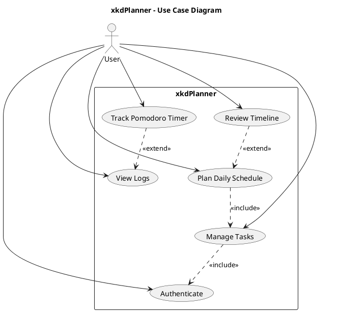
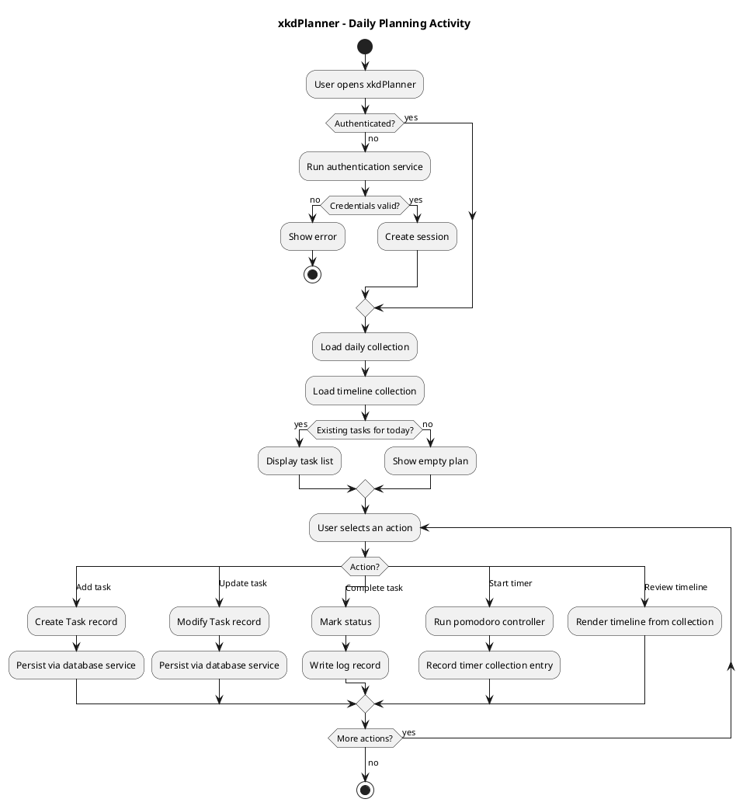
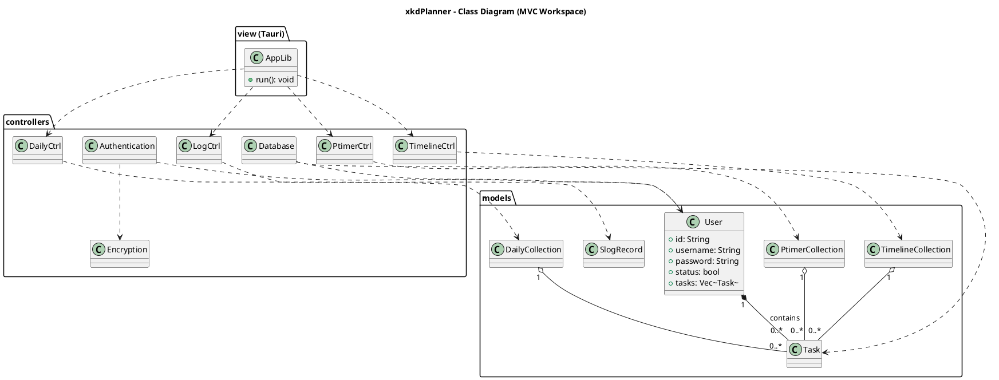
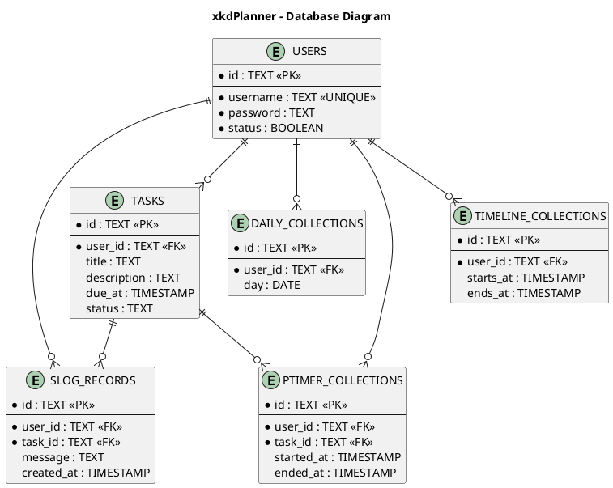

<div align="center">

# xkdPlanner

*A desktop organization tool built in Rust, with a React + TypeScript Tauri front-end.*


</div>

---

## Contents

- [About](#about)
- [Architecture](#architecture)
- [Crates, `lib.rs`, and `mod`](#crates-librs-and-mod)
- [Implementation guide](#implementation-guide)
- [Frontend](#frontend)
- [Diagrams](#diagrams)
- [Shell scripts](#shell-scripts)
- [MVP roadmap](#mvp-roadmap)
- [Getting started](#getting-started)
- [License](#license)

## About

> Since I've been exploring new programming languages, I've decided to demonstrate my knowledge in the form of this useful organization-focused app. This solution is entirely based on the Rust programming language, effectively being my first solution implemented in it, plus some JS for the front-end, given we're using *Tauri*.

The backend is a **Cargo Workspace** split into MVC crates. The front-end is a **Vite + React + TypeScript** app living next to the Tauri crate. Rust files are intentionally **skeletons**: every public type and function already exists with a `todo!()` body and a hint comment. The React screens and the typed command wrappers are also skeletons — UI and types are in place, command bodies remain to be implemented in Rust. The shell scripts, however, are complete — you do not need to touch them.

## Architecture

Dependencies flow in one direction only:

```text
view (Tauri + React/TS)  ──▶  controllers  ──▶  models
```

| Crate | MVC role | Responsibility | Public entry |
| :--- | :--- | :--- | :--- |
| `crates/models` | Model | Data shape only: records, collections, shared types | `crates/models/src/lib.rs` |
| `crates/controllers` | Controller | Handlers + every service (database, encryption, authentication) | `crates/controllers/src/lib.rs` |
| `src/view/src-tauri` | View | Tauri shell and `#[tauri::command]` bridge | `src/view/src-tauri/src/lib.rs` |
| `src/view/frontend` | View | React UI, TypeScript types, command wrappers | `src/view/frontend/src/App.tsx` |

```text
xkdPlanner/
├── Cargo.toml                  # virtual workspace manifest
├── package.json                # npm scripts: dev / build / preview
├── vite.config.ts              # Vite root + dist/web output
├── tsconfig.json               # strict TypeScript config
├── crates/
│   ├── models/src/
│   │   ├── lib.rs              # re-exports User, Task, SlogRecord, ...
│   │   ├── records/{mod.rs, user_record.rs, task_record.rs, slog_record.rs}
│   │   └── collections/{mod.rs, daily_collection.rs, ptimer_collection.rs, timeline_collection.rs}
│   └── controllers/src/
│       ├── lib.rs              # AppServices + re-exports model types
│       ├── controllers/{mod.rs, daily_ctrl.rs, log_ctrl.rs, ptimer_ctrl.rs, timeline_ctrl.rs}
│       └── services/{mod.rs, database.rs, encryption.rs, authentication.rs}
├── src/view/src-tauri/         # Tauri app (not moved)
├── src/view/frontend/          # React + TypeScript UI
│   ├── index.html
│   └── src/{main.tsx, App.tsx, api.ts, styles.css}
├── src/scripts/                # complete shell scripts
├── docs/diagrams/              # rendered UML PNGs
└── dist/                       # generated web assets + timestamped builds
    ├── web/                    # Vite output, loaded by Tauri
    └── <unix-ms>/              # self-contained release artifacts
```

## Crates, `lib.rs`, and `mod`

### Crate = compilation unit

A **crate** is one compilation unit. It is a package with either:

- `src/lib.rs` — a **library crate**: exposes reusable items, no entry point.
- `src/main.rs` — a **binary crate**: must define `fn main()`.

A package can have both. Our Tauri package does: `main.rs` is tiny and calls `app_lib::run()` from `lib.rs`, where the commands and setup live.

The root `Cargo.toml` is a **virtual workspace manifest**: it has no `[package]`, so it compiles nothing itself. It only lists members:

```toml
[workspace]
members = ["crates/models", "crates/controllers", "src/view/src-tauri"]
resolver = "2"
```

That is why there is no `src/lib.rs` or `src/main.rs` at the repository root anymore, and why `crates/` lives there: each member is an independent crate with its own `src/`.

| Crate | Kind | Root file | What it exposes |
| :--- | :--- | :--- | :--- |
| `models` | library | `crates/models/src/lib.rs` | `User`, `Task`, `SlogRecord`, collections |
| `controllers` | library | `crates/controllers/src/lib.rs` | `AppServices`, handlers, services |
| `app` (Tauri) | binary + library | `src/view/src-tauri/src/main.rs` + `lib.rs` | commands, `run()` |

### `lib.rs` — the crate root

`lib.rs` is where a library's public API starts. It declares modules and re-exports the items callers should use:

```rust
pub mod records;
pub use records::user_record::User;
```

Thanks to `pub use`, another crate writes `use models::User;` instead of `use models::records::user_record::User;`. Re-exports are the front door of the crate.

### `mod` — declaring modules

The `mod` keyword tells Rust to compile another file as part of the current crate. It is not an import — it is a declaration:

```rust
mod records; // looks for src/records.rs or src/records/mod.rs
```

For a folder module, `records/mod.rs` declares its children:

```rust
pub mod user_record;
pub mod task_record;
```

So the chain is:

```text
crates/models/src/lib.rs          -> pub mod records;
crates/models/src/records/mod.rs  -> pub mod user_record;
crates/models/src/records/user_record.rs -> pub struct User { ... }
```

If a file is not reached by a `mod` declaration, Rust never compiles it. If it is declared with plain `mod`, it stays private to that crate.

### Visibility and imports

| Keyword | Meaning |
| :--- | :--- |
| `pub` | visible outside the crate |
| `pub(crate)` | visible anywhere inside the same crate only |
| nothing | visible only in the current module and its children |
| `use` | brings an existing path into scope; does not declare anything |

Use `pub mod` when another crate must reach the module, `pub(crate)` for sibling modules, and plain `mod` for internal helpers. Any new public type should also get a `pub use` line in its crate's `lib.rs` so imports stay short.

**Common mistakes**

- Creating a `.rs` file without adding a `mod` line — it is silently ignored.
- Forgetting `pub` on a type you need from another crate.
- Putting business logic in `lib.rs` instead of a submodule — keep the root as a table of contents.
- Expecting `todo!()` to fail compilation — it compiles fine and only panics when called.

## Implementation guide

Work bottom-up, in this order. Each step ends with a type-check so errors stay local.

**1. Models (`crates/models`)**

- Start with `task_record.rs` and `user_record.rs`: implement `new`, `complete`, `is_completed`, `active_tasks`, `completed_tasks`, `redacted`.
- Hints: `Vec::new()` for empty lists, `Iterator::filter` for active/completed, and clone-then-clear for `redacted`.
- Then do the three collections. `DailyCollection::add_task` should check `Vec::contains` before pushing; `remove_task` can use `Vec::retain`.
- Keep model methods **pure** — no database calls here. If you need a query, it belongs in `controllers`.

**2. Services (`crates/controllers/src/services`)**

- `encryption.rs`: use `sha2::{Digest, Sha256}` for password hashing. `to_hex`/`from_hex` are private helpers you must implement. XOR encryption is fine for learning, but note it is *not* production-grade; swap in `argon2`/`aes-gcm` later.
- `database.rs`: use `sqlx::query(...)` with `.bind(...)` (runtime queries), not `query!` macros — macros require a live database at compile time. `init()` should run `CREATE TABLE IF NOT EXISTS` for all five tables. Each `map_*` helper uses `row.try_get("column")?`.
- `in_memory()` uses `sqlite::memory:` with `max_connections(1)` so tests share one database.
- `authentication.rs`: validate input, reject duplicates, hash before storing, and return `user.redacted()` so hashes never reach the UI.

**3. Handlers (`crates/controllers/src/controllers`)**

- These should be 1–3 lines: call the matching `db` method. If a handler grows business logic, move that logic into a service.
- Turn errors into `AppError` (already defined in `services/mod.rs`) when the View needs a friendly message.

**4. View (`src/view/src-tauri` + `src/view/frontend`)**

- Each `#[tauri::command]` receives `tauri::State<'_, AppServices>`. Call a controller handler, then `.map_err(|e| e.to_string())` because Tauri command errors must be serializable strings.
- `run()` manages `AppServices` with `.manage(...)` and registers every command in `generate_handler![...]`.
- On the TypeScript side, call commands only through `src/view/frontend/src/api.ts`. That wrapper uses `invoke` from `@tauri-apps/api/core`, so the UI never touches `window.__TAURI_INTERNALS__` directly.
- Tauri maps camelCase argument keys (`userId`, `dueAt`) to Rust snake_case parameters (`user_id`, `due_at`).
- When you change a Rust struct field, update the matching interface in `api.ts` — the shape is duplicated on purpose for this small project.

**Common pitfalls**

- Do not return `User.password` to the front-end — use `redacted()`.
- Do not call `Database` from Tauri commands; go through controller handlers.
- `todo!()` compiles but panics at runtime. Expect panics until the bodies are filled in.
- `cargo check --workspace` passes even with stubs; that only proves the wiring is correct.
- `npm run build` type-checks the UI but cannot verify that Rust command names exist; keep both sides in sync manually.

## Frontend

Stack: **React 19**, **TypeScript 5**, **Vite 6**, `@tauri-apps/api` 2. npm scripts run from the repository root.

| File | Purpose |
| :--- | :--- |
| `package.json` | dependencies and `dev` / `build` / `preview` scripts |
| `vite.config.ts` | sets the Vite root to `src/view/frontend` and output to `dist/web` |
| `tsconfig.json` | strict mode, `jsx: react-jsx`, bundler resolution, no emit |
| `src/view/frontend/index.html` | HTML shell with `#root` mount point |
| `src/view/frontend/src/main.tsx` | React 19 `createRoot` bootstrap |
| `src/view/frontend/src/App.tsx` | skeleton screens: tasks, timer, timeline, logs |
| `src/view/frontend/src/api.ts` | typed `invoke` wrappers mirroring Rust commands |
| `src/view/frontend/src/styles.css` | plain CSS with light/dark support |

Tauri points at this output in `src/view/src-tauri/tauri.conf.json`:

```json
{
  "build": {
    "frontendDist": "../../../dist/web",
    "devUrl": "http://localhost:1420",
    "beforeDevCommand": "npm run dev",
    "beforeBuildCommand": "npm run build"
  }
}
```

Development loop:

```bash
npm install          # once
npm run dev          # Vite at http://localhost:1420
npm run build        # tsc --noEmit && vite build -> dist/web
cargo tauri dev      # if the Tauri CLI is installed; runs npm run dev first
```

## Diagrams

Rendered with PlantUML; only images are kept in the repository.

| Use case | Activity |
| :---: | :---: |
|  |  |

| Class | Database |
| :---: | :---: |
|  |  |

## Shell scripts

Both scripts live in `src/scripts/` and are already finished.

**`init_crate.sh <name>`** scaffolds `crates/<name>/` with a `Cargo.toml` that inherits `version`/`edition` from the workspace, plus an empty `lib.rs`. It validates the name, refuses to overwrite an existing crate, and prints the exact workspace entry, dependency line, and `use` statement to add.

```bash
./src/scripts/init_crate.sh reporting
# prints: use reporting::<public_item>;
```

**`build_app.sh`** builds the React front-end first, checks the Rust workspace, builds the Tauri binary in release mode, and writes a self-contained artifact folder to `dist/<unix-ms>/`:

```text
dist/1763318400123/
├── xkdPlanner        # release binary
├── index.html        # Vite output
├── assets/           # hashed JS + CSS bundles
└── BUILD_INFO.txt    # timestamp, UTC build time, node/npm/rustc versions
```

```bash
./src/scripts/build_app.sh
```

The folder name is `$(date +%s%3N)` — Unix time in milliseconds — so successive builds never collide.

## MVP roadmap

**Foundation** — done

- [x] Cargo Workspace with MVC crates
- [x] Populated `lib.rs` / `mod.rs` files and crate re-exports
- [x] Tauri kept in place and wired to `controllers`
- [x] Public struct fields and fixed imports
- [x] React + TypeScript front-end with typed command wrappers
- [x] Complete shell scripts and rendered UML diagrams
- [x] README architecture, module system, frontend setup, and implementation guide

**Models** — your turn

- [ ] Implement `Task`, `SlogRecord`, and the three collections
- [ ] Derive `serde` traits on all public records (already in place)

**Services** — your turn

- [ ] `authentication` register/login flow
- [ ] `database` schema + CRUD queries
- [ ] `encryption` hashing helpers
- [ ] Unit tests for service logic

**View** — your turn

- [ ] Implement Tauri command bodies delegating to controller handlers
- [x] Front-end screens (daily plan, tasks, timer, timeline, logs)
- [ ] Wire front-end events to working commands
- [ ] End-to-end smoke test

## Getting started

Requirements: Rust 1.85+, Node.js 20+, npm, and the [Tauri system prerequisites](https://v2.tauri.app/start/prerequisites/).

```bash
# install front-end dependencies (once)
npm install

# type-check and bundle the UI
npm run build

# type-check every Rust crate
cargo check --workspace

# run the unit tests you add
cargo test --workspace

# scaffold a crate
./src/scripts/init_crate.sh <name>

# produce a timestamped release artifact (frontend + binary)
./src/scripts/build_app.sh
```

## License

Released under the **MIT License**. See [LICENSE](LICENSE) for the full text.

> Copyright (c) 2026, Túlio Horta — github.com/tuliofh01

<!--
MIT License

Copyright (c) 2026, Túlio Horta - (github.com/tuliofh01)

Permission is hereby granted, free of charge, to any person obtaining a copy
of this software and associated documentation files (the "Software"), to deal
in the Software without restriction, including without limitation the rights
to use, copy, modify, merge, publish, distribute, sublicense, and/or sell
copies of the Software, and to permit persons to whom the Software is
furnished to do so, subject to the following conditions:

The above copyright notice and this permission notice shall be included in all
copies or substantial portions of the Software.

THE SOFTWARE IS PROVIDED "AS IS", WITHOUT WARRANTY OF ANY KIND, EXPRESS OR
IMPLIED, INCLUDING BUT NOT LIMITED TO THE WARRANTIES OF MERCHANTABILITY,
FITNESS FOR A PARTICULAR PURPOSE AND NONINFRINGEMENT. IN NO EVENT SHALL THE
AUTHORS OR COPYRIGHT HOLDERS BE LIABLE FOR ANY CLAIM, DAMAGES OR OTHER
LIABILITY, WHETHER IN AN ACTION OF CONTRACT, TORT OR OTHERWISE, ARISING FROM,
OUT OF OR IN CONNECTION WITH THE SOFTWARE OR THE USE OR OTHER DEALINGS IN THE
SOFTWARE.
-->
